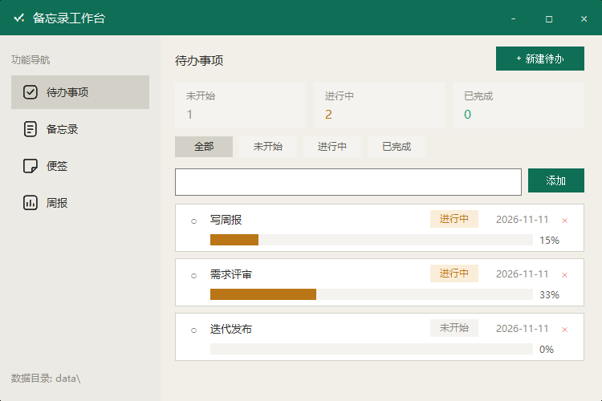
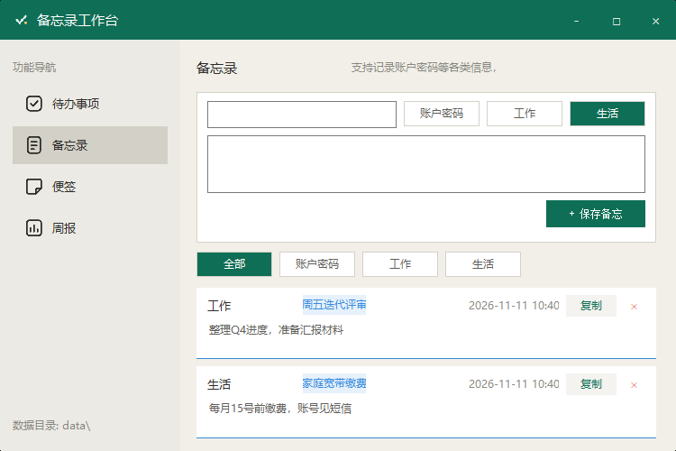
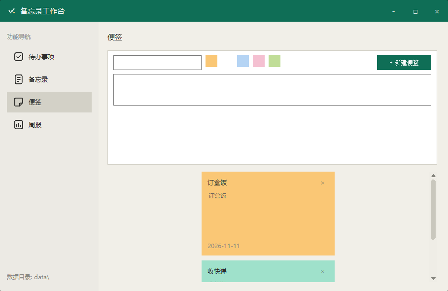
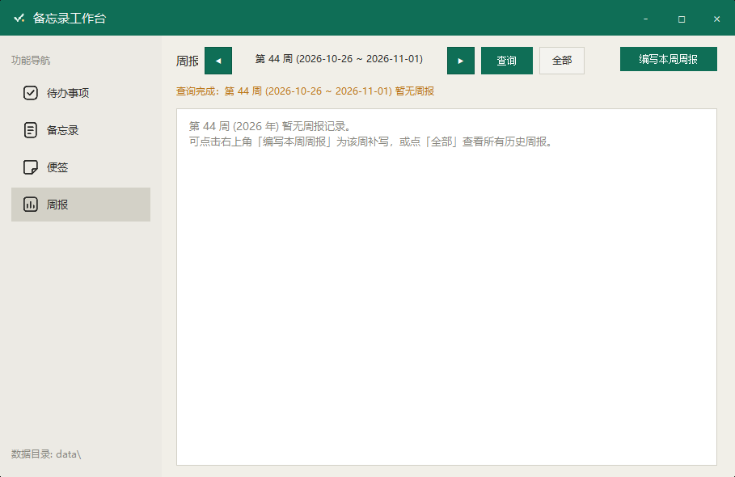

# MemoApp — 备忘录工作台

一款基于 **DuiLib** 的 Windows 桌面备忘录应用。UI 资源打包内嵌进 exe，**单个 exe 即可独立运行**（无需安装、无需数据库服务）。

 -green) -orange)

## 效果图

| 待办事项 | 备忘录 |
|------|------|
|  |  |
| **便签** | **周报** |
|  |  |

## 功能一览

| 模块 | 功能 |
|------|------|
| **待办事项** | 任务增删、状态标记（未开始/进行中/已完成）、进度条、截止日期、状态筛选、统计卡片 |
| **备忘录** | 分类管理（账户密码/工作/生活）、单选分类 Option（选中青绿底白字）、按分类筛选（单选互斥）、一键复制、删除 |
| **便签** | 彩色便签墙（5 色）、添加/删除 |
| **周报** | 编写周报（本周完成/下周计划/问题与风险，可从待办一键导入）、◀/▶ 选周 + **查询按钮**按周查询历史、**全部**查看所有周报、草稿/提交状态 |

**窗口行为**：

- 自定义标题栏：最小化 / 最大化 / 关闭
- **关闭 = 隐藏到托盘**（气泡提示一次），左键托盘图标恢复窗口，右键菜单可“显示主界面 / 退出”，退出后进程干净结束
- 程序图标（exe / 任务栏 / 标题栏 / 托盘共用 `app.ico`）

## 目录结构

```
MemoApp/
├── build.bat               # 一键编译脚本（见下文）
├── CMakeLists.txt          # 顶层构建
├── start_mysql.bat         # [可选] 启动本地 MySQL（默认方案已不用）
├── image/                  # 界面效果图（README 引用）
├── src/                    # 应用源码
│   ├── main.cpp            # 入口：解内嵌 zip 资源、创建主窗口、消息循环
│   ├── MainWindow.*        # 主窗口：导航切换、托盘、标题栏
│   ├── StdAfx.h            # 公共头（using namespace DuiLib）
│   ├── NodeHelper.h        # Node 组件辅助（含滚动条统一样式）
│   ├── NodeMessages.h      # Node 间消息定义
│   ├── MemoApp.rc          # 资源：skin.zip 内嵌（ZIPRES RCDATA）+ app.ico
│   ├── resource.h
│   ├── nodes/              # ★ 四大功能模块，每个 Tab 一个 Node 组件
│   │   ├── TodoNode.*      #   待办（含进度）
│   │   ├── MemoNode.*      #   备忘录（含账户密码）
│   │   ├── NoteNode.*      #   便签
│   │   └── ReportNode.*    #   周报（本地 SQLite 存取）
│   └── data/               # 数据层
│       ├── DataStore.*     # 待办/备忘录/便签 → 本地文本（data\*.txt，TSV 格式）
│       ├── ReportTypes.h   # 周报公共类型（ReportItem/WeekInfo）+ ISO 周工具
│       ├── WeekUtil.cpp    # ISO 周计算公共实现
│       ├── LocalDB.*       # ★ SQLite 封装：周报 CRUD + 通用 Exec/Query
│       └── ReportDB.*      # [保留] MySQL 版周报存取（默认不参与编译）
├── resources/
│   ├── skin/               # UI 皮肤：main.xml + icons/ + logo.png
│   ├── skin.zip            # 打包产物（正斜杠条目，由 build.bat 生成）
│   └── app.ico             # 多尺寸程序图标（256/64/48/32/16）
├── third_party/            # 第三方库（全部随源码自带，无需安装）
│   ├── DuiLib/             #   DuiLib 源码（静态编译编入 exe）
│   ├── sqlite/             #   SQLite amalgamation（sqlite3.c/h）
│   └── mysql/              #   [保留] MySQL 8.0.44 便携版 + Connector
└── out/                    # 产物：MemoApp.exe（build.bat 复制到此）
```

## 编译

### 依赖

- Visual Studio 2022（v143 工具集）
- CMake ≥ 3.20
- Python 3（仅用于打包 skin.zip）

### 一键编译

```bat
cd /d J:\MemoApp
build.bat            :: Release 编译（默认）
build.bat Debug      :: Debug 编译
build.bat clean      :: 删除 build 目录，完全重新配置编译
```

脚本流程：

0. **预检**：检测到 `MemoApp.exe` 正在运行会直接提示“请先退出程序（托盘图标右键→退出）”——运行中的程序会锁定 `out\MemoApp.exe` 导致复制产物失败
1. 清除重复代理环境变量（`HTTPS_PROXY/https_proxy` 大小写重复键会导致 MSBuild 崩溃）
2. 用 Python zipfile 打包 `skin.zip`（保证 zip 内条目为**正斜杠路径**——PowerShell 的 Compress-Archive 会生成反斜杠条目导致图标全部加载失败）
3. CMake 配置（VS2022 / x64 / v143）
4. 编译（并行度 4；DuiLib 静态库 + SQLite + 业务代码全部编进 exe）
5. 复制产物到 `out\MemoApp.exe`

> 若 `out\MemoApp.exe` 或 build 中间产物被清理，重新运行 `build.bat` 即可（首次全量编译约 3–5 分钟）。

## 运行

**双击 `out\MemoApp.exe` 即可**，无需任何安装或服务：

- 首次运行自动在 exe 旁创建 `data\` 目录
- 周报数据：`data\reports.db`（SQLite，首次自动建表 `weekly_reports`）
- 待办/备忘录/便签数据：`data\` 下各文本文件（`todos.txt / memos.txt / notes.txt`，TSV 格式，UTF-8 带 BOM）

## 数据存储方案

| 数据 | 位置 | 说明 |
|------|------|------|
| 待办 / 备忘录 / 便签 | `data\*.txt` | TSV 文本文件，随改随存 |
| 周报（历史/草稿） | `data\reports.db` | **SQLite** 单文件库，程序内置引擎，免服务免连接 |
| （可选）MySQL | `127.0.0.1:3306 / memo_app` | 旧方案，代码保留未删除 |

`LocalDB` 类提供两层接口：

- 业务接口：`Open / IsOpen / UpsertReport / LoadReports / DeleteReport`
- 通用接口：`Exec(sql)` 执行任意 SQL、`Query(sql)` 返回按列名组织的结果集 —— 以后想把待办、备忘录迁入同一个 db 文件，直接调用即可

如需切回 MySQL 版周报：运行 `start_mysql.bat`，再重新编译时打开开关 `build.bat` 改用 `cmake -DMEMOAPP_USE_MYSQL=ON ..`（会把 ReportDB.cpp 编回并链接 mysqlclient，此时 exe 运行需 MySQL bin 目录下的 `libssl-3-x64.dll`/`libcrypto-3-x64.dll` 等 OpenSSL DLL——MySQL 静态客户端自身依赖它们，无法编入单 exe）。

## 架构说明（Node 组件机制）

沿用 DuiLib Ultimate 的组件开发模式（参考 `DuiLib_Ultimate/Demos/duidemo/NodeDemo`）：

- 每个 Tab 是一个 `CNodeUIBase` 子类（`TodoNodeUI / MemoNodeUI / NoteNodeUI / ReportNodeUI`），由 `CNodeUIManager` 统一管理生命周期与消息分发
- 主窗口 XML（`main.xml`）中页面容器为 `TabLayout`，四个 Node 依次挂载；导航按钮点击调用 `SelectItem` 切页
- Node 之间通过 `PostNodeMessage` 广播联动（如待办数据变化通知周报模块刷新“从待办汇总”）

### 资源内嵌机制（单 exe 的关键）

1. `build.bat` 打包 `resources/skin/` → `skin.zip`（正斜杠条目）
2. `.rc` 将其作为 `IDR_SKIN ZIPRES` RCDATA 嵌入 exe，`app.ico` 同步嵌入
3. `main.cpp` 启动时 `FindResource(MAKEINTRESOURCE(IDR_SKIN), "ZIPRES")` 取出内存 zip，`CPaintManagerUI::SetResourceZip(mem, size)` 设置
4. DuiLib 的 XML 与图片加载均优先走内存 zip —— exe 不依赖任何外部文件

## 已知注意事项（踩坑记录）

- **编译前先退出程序**：`MemoApp.exe` 运行中会锁定 `out\MemoApp.exe`，`build.bat` 已加预检提示
- **skin.zip 条目必须是正斜杠**，且**不要用 PowerShell Compress-Archive 打包**（反斜杠条目 → 图标全挂）；改皮肤后重跑 `build.bat` 会自动重新打包
- **rc 中的数字资源 ID 必须用 `MAKEINTRESOURCE` 查找**，字符串名查不到
- `main.xml` 的 `bkimage` 等复合属性值内**只允许单引号嵌套**，双引号会提前闭合导致整个 XML 解析失败（报“加载资源文件 main.xml 失败”）
- **主窗口不能拦截所有 `WM_COMMAND`**：原生编辑框（CEditUI）的 `EN_CHANGE` 文本同步依赖 `WM_COMMAND` 反射通道，托盘菜单命令的 `lParam` 为 0、编辑框通知的 `lParam` 为控件句柄，须按 `lParam == 0` 区分放行，否则输入框取文本永远为空
- **主窗口销毁时必须 `::PostQuitMessage(0)`**：DuiLib 的 `MessageLoop` 只在收到 `WM_QUIT` 时退出，漏掉会导致窗口关了、进程还在（僵尸进程）
- **滚动条图片样式**：`<Default VScrollBar>` 只在控件已挂接 PaintManager 时生效，Node 组件在构造期（未挂接）创建的滚动条不会应用默认样式，需在代码里对 `GetScrollBar()` 逐项设置图片属性
- **ISO 周计算**：周号要与「1 月 4 日所在周的周四」相减（直接与 1 月 4 日相减整除会错一周）；日期加减须用本地时间 `mktime`，`_mkgmtime` 会把本地时间按 UTC 解释导致日期漂移
- 环境变量中 `HTTPS_PROXY` 与 `https_proxy` 并存时 MSBuild 会崩，`build.bat` 已自动处理；手动跑 cmake 时需 `env -u HTTPS_PROXY -u https_proxy ...`
- `pageContainer` 必须是 `TabLayout`；强转其他布局类型调用 `SelectItem` 属未定义行为（四页同屏叠加）

## 后续可扩展

- 待办/备忘录/便签迁入 `reports.db`（用 `LocalDB::Query/Exec` 即可）
- 便签墙瀑布流多列布局、备忘录分类自定义增删
- 周报导出图片 / 复制文本
- 开机自启 + 托盘常驻
